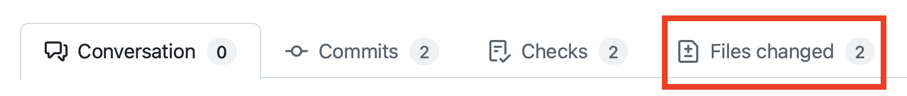

| [← Lição anterior: Gerenciar agentes][previous-lesson] |
|:--|

## Revise o trabalho

Durante este laboratório, você trabalhou com o GitHub Copilot em várias tarefas para melhorar a experiência do usuário e adicionar funcionalidades. Você pediu ao Copilot que adicionasse documentação ao código, desenvolvesse um recurso de jogos relacionados para a equipe de design iterar e implementasse recursos de acessibilidade, incluindo opções para alternar entre os modos de alto contraste e claro. Vamos explorar as mudanças no código e, se necessário, fornecer comentários ao Copilot para aprimorar o trabalho.

### Cenário

Como já destacamos várias vezes, os fundamentos do design de software e do DevOps não mudam com a inclusão da IA generativa. Sempre devemos revisar o código gerado e seguir nosso processo normal de DevOps. Com isso em mente, vamos revisar as sugestões do GitHub Copilot para adicionar documentação, o recurso de jogos relacionados e os recursos de acessibilidade antes de habilitar a revisão pela equipe.

## Segurança e o agente de nuvem do GitHub Copilot

Como o agente de nuvem do Copilot executa tarefas de forma assíncrona e sem supervisão, foram implementadas algumas restrições de segurança para garantir que tudo continue protegido. Entre elas:

- O Copilot tem acesso de leitura ao repositório e acesso de gravação **somente** ao branch que usará para o código.
- O agente de nuvem é executado no GitHub Actions, que cria um ambiente separado e efêmero para o trabalho.
- Todos os fluxos de trabalho do GitHub Actions precisam ser aprovados por uma pessoa antes de serem executados.
- [O acesso a recursos externos é limitado por padrão](https://docs.github.com/copilot/how-tos/copilot-on-github/customize-copilot/customize-cloud-agent/customize-the-agent-firewall), incluindo o acesso a servidores MCP.

## Revise a documentação gerada

Vamos começar explorando o primeiro pull request (PR) gerado pelo agente de nuvem do GitHub Copilot: a adição de documentação ao código. Para isso, use a interface padrão de PRs do GitHub.com.

> [!NOTE]
> Ao explorar o PR, você poderá ver um aviso de que o GitHub Copilot está bloqueado por um firewall. Isso é **esperado**, pois o acesso do Copilot a recursos externos é limitado por padrão, incluindo chamadas a servidores MCP externos. Se quiser, você pode [personalizar ou desabilitar o firewall do agente de nuvem do Copilot][agent-firewall].

1. Retorne ao seu repositório no github.com.
2. Selecione **Pull Requests** para abrir a lista de pull requests.
3. Abra o pull request com um título semelhante a **Add missing documentation** ou outro título mais específico.

> [!NOTE]
> Se o Copilot ainda estiver trabalhando na tarefa, o pull request terá a marca **[WIP]**. Nesse caso, aguarde a conclusão do trabalho pelo Copilot. Isso pode levar alguns minutos, então faça uma pausa ou reflita sobre o que aprendeu até agora.

4. Quando o pull request estiver pronto, selecione a guia **Files changed** e revise as mudanças.

    

5. Explore o código atualizado, que inclui comentários TSDoc recém-criados e outras documentações. As mudanças exatas podem variar.

    Ao examinar as mudanças, procure comentários TSDoc, convenções de TypeScript e cabeçalhos de comentário. Eles são provenientes dos arquivos de instruções personalizadas revisados no início do Exercício 2.

6. Depois de revisar as atualizações e confirmar que estão corretas, retorne à guia **Conversation** e role para baixo.
7. Você deverá ver um indicador de que alguns fluxos de trabalho estão aguardando aprovação.
8. Se houver fluxos de trabalho aguardando aprovação, selecione **Approve and run workflows**.

   
9. Os fluxos de trabalho deverão entrar na fila da seção de verificações do pull request. Se tudo correr bem, as verificações do projeto para o único aplicativo Astro serão aprovadas. Isso pode levar alguns minutos.

## Solicite mudanças ao GitHub Copilot

Trabalhar com o Copilot em um pull request não é uma via de mão única. Você também pode mencionar o Copilot em comentários do pull request — como faria com outros membros da equipe — ou em comentários em linha no código. O Copilot verá esses comentários e iniciará outra sessão para resolvê-los. Como os resultados são não determinísticos, não podemos fornecer um texto exato para solicitar as mudanças. Algumas ideias do que você pode pedir ao Copilot:

- Adicionar cabeçalhos de comentário ao início de cada arquivo de código com uma breve descrição do que ele faz.
- Adicionar comentários TSDoc a arquivos TypeScript e Astro.
- Criar um README com uma descrição da estrutura do aplicativo Astro.

1. Adicione um comentário solicitando uma mudança na documentação gerada e mencione **@copilot**, como faria com qualquer usuário. Use uma das ideias acima ou outra sugestão de documentação que gostaria de ver na base de código.
2. Selecione **View Session** para acompanhar o trabalho do Copilot. Observe como ele inicia uma nova sessão para fazer as atualizações.
3. Você pode selecionar **Back to pull request** para retornar ao pull request.

    

4. Depois que o Copilot concluir as mudanças, um novo commit deverá aparecer no pull request.
5. Selecione a guia **Files changed** para revisar as mudanças.

Continue iterando até ficar satisfeito. Depois, você poderá converter o PR de rascunho em pronto para revisão e fazer o merge no branch principal.


## Revise o recurso de jogos relacionados

Vamos voltar ao PR criado pelo Copilot para resolver a issue de exibir jogos relacionados na página de detalhes de cada jogo.

1. Retorne ao seu repositório no GitHub.com.
2. Selecione a guia **Pull Requests**.
3. Selecione o PR com um título semelhante a **Show related games on the game details page** ou outro título mais específico.
4. Selecione a guia **Files changed** para revisar o código gerado.
5. Depois de revisar as atualizações e confirmar que estão corretas, retorne à guia **Conversation** e role para baixo.
6. Você deverá ver um indicador de que alguns fluxos de trabalho estão aguardando aprovação.
7. Se houver fluxos de trabalho aguardando aprovação, selecione **Approve and run workflows**.

   

8. Os fluxos de trabalho deverão entrar na fila da seção de verificações do pull request. Se tudo correr bem, as verificações do projeto para o único aplicativo Astro serão aprovadas. Isso pode levar alguns minutos.
9. **Opcional:** você pode mudar para esse branch no Codespace para testar manualmente o recurso de jogos relacionados. Acesse seu Codespace, abra o terminal e execute os comandos a seguir (substitua `<branch-name>` pelo nome do branch criado pelo Copilot, por exemplo, **copilot/fix-8**):

    ```bash
    git fetch origin
    git checkout <branch-name>
    ```

O Copilot criou o recurso de jogos relacionados! Como antes, você pode iterar com o agente de nuvem do Copilot para solicitar atualizações. Por exemplo, você pode pedir ao Copilot que altere a quantidade de jogos relacionados exibidos ou garanta a inclusão de cabeçalhos de comentário e comentários TSDoc (lembre-se: a tarefa foi atribuída **antes** da atualização das instruções personalizadas!). Como antes, você pode fazer essas solicitações adicionando um comentário na guia **Conversation**. O Copilot verá o comentário e iniciará uma nova sessão.

## Revise os recursos de acessibilidade

Por fim, vamos revisar os recursos de acessibilidade implementados com o agente personalizado de acessibilidade. Este PR deve incluir tanto o modo de alto contraste atribuído no Exercício 3 quanto o modo claro solicitado no painel de controle durante o Exercício 4.

1. Retorne ao seu repositório no GitHub.com.
2. Selecione a guia **Pull Requests**.
3. Selecione o PR com um título semelhante a **Add high contrast mode to website** ou outro título mais específico.

> [!NOTE]
> Se o Copilot ainda estiver trabalhando na tarefa, o pull request terá a marca **[WIP]**. Nesse caso, aguarde a conclusão do trabalho. Isso pode levar alguns minutos.

4. Selecione a guia **Files changed** para revisar o código gerado.
5. Revise a implementação, prestando atenção especial a:
   - Os componentes da interface para alternar entre os modos.
   - O uso do armazenamento local para manter as preferências do usuário.
   - As mudanças de CSS ou de estilo nos modos de alto contraste e claro.
   - Os atributos de acessibilidade (rótulos ARIA, navegação pelo teclado etc.).
   - Qualquer código JavaScript/TypeScript que gerencie a alternância entre os modos.

6. Depois de revisar as atualizações e confirmar que estão corretas, retorne à guia **Conversation** e role para baixo.
7. Você deverá ver um indicador de que alguns fluxos de trabalho estão aguardando aprovação.
8. Se houver fluxos de trabalho aguardando aprovação, selecione **Approve and run workflows**.

   

9. Os fluxos de trabalho deverão entrar na fila da seção de verificações do pull request. Se tudo correr bem, as verificações do projeto para o único aplicativo Astro serão aprovadas. Isso pode levar alguns minutos.
10. **Opcional:** você pode mudar para esse branch no Codespace para testar manualmente os recursos de acessibilidade. Acesse seu Codespace, abra o terminal e execute os comandos a seguir (substitua `<branch-name>` pelo nome do branch criado pelo Copilot):

    ```bash
    git fetch origin
    git checkout <branch-name>
    ```

    Em seguida, inicie o aplicativo e teste os modos de alto contraste e claro no navegador para confirmar que funcionam como esperado e persistem após recarregar a página.

Observe como o agente personalizado de acessibilidade ajudou a orientar o Copilot para implementar esses recursos seguindo as práticas recomendadas de acessibilidade. Se você identificar problemas ou melhorias de acessibilidade, poderá mencionar **@copilot** em um comentário para solicitar atualizações, como fez com os PRs anteriores.

## Exercício opcional — continue delegando

O agente de nuvem funciona melhor quando você pode delegar itens reais do backlog e se dedicar a outras tarefas. Para desenvolver esse hábito, crie mais algumas issues no repositório e atribua-as ao Copilot. Algumas ideias:

- Criar um formulário de interesse de apoiadores na página de detalhes do jogo.
- Implementar paginação na página de lista de jogos.
- Adicionar validação de entrada e tratamento de erros aos helpers de acesso a dados.

## Resumo

Você concluiu o roteiro do agente de nuvem. Nestas lições, você:

- **Inspecionou os arquivos de instruções personalizadas incluídos no repositório** para observar mais tarde o efeito deles na saída do agente de nuvem.
- **Atribuiu issues ao agente de nuvem do Copilot** e acompanhou a configuração do ambiente, o planejamento e a execução assíncrona.
- **Criou e usou um agente personalizado** para acessibilidade, adicionando opções para alternar entre os modos de alto contraste e claro.
- **Usou a página de agentes do Copilot como painel de controle** para monitorar e direcionar a sessão de acessibilidade em andamento.
- **Revisou e iterou nos pull requests do agente de nuvem**, mencionando `@copilot` para solicitar mudanças e aprovando fluxos de trabalho.

## Revisão e próximos passos

Você concluiu o roteiro do agente de nuvem. Se quiser continuar explorando, os outros roteiros complementam o que você praticou aqui:

- 🖥️ **[Roteiro do VS Code](../../vscode/)** — explore o modo de agente do Copilot Chat e a integração com MCP diretamente no IDE.
- 💻 **[Roteiro do CLI](../../cli/)** — entregue duas mudanças revisadas pelo terminal com os modos Plan e Autopilot, skills de agente, um agente de QA personalizado, Playwright MCP, Agent Merge e uma integração opcional de `/delegate` com o agente de nuvem.

No seu próprio repositório, experimente estas ideias:

- Atribua ao agente de nuvem uma issue de refatoração ou de cobertura de testes.
- Crie um agente personalizado para outro domínio.
- Configure `copilot-setup-steps.yml` para outra pilha de tecnologias.

## Recursos

- [GitHub Copilot][github-copilot]
- [Sobre os agentes do Copilot][copilot-agents]
- [Atribuir issues do GitHub ao Copilot][assign-issue]
- [Práticas recomendadas para o fluxo de configuração do agente de nuvem do Copilot][cloud-agent-best-practices]
- [Configurar o firewall do agente de nuvem do Copilot][agent-firewall]

---

| [← Lição anterior: Gerenciar agentes][previous-lesson] |
|:--|

[github-copilot]: https://github.com/features/copilot
[cloud-agent-overview]: https://docs.github.com/copilot/concepts/agents/cloud-agent/about-cloud-agent
[assign-issue]: https://docs.github.com/copilot/how-tos/use-copilot-agents/cloud-agent/start-copilot-sessions
[setup-workflow]: https://docs.github.com/copilot/how-tos/copilot-on-github/customize-copilot/customize-cloud-agent/customize-the-agent-environment
[copilot-agents]: https://docs.github.com/copilot/concepts/agents/cloud-agent/about-cloud-agent
[cloud-agent-best-practices]: https://docs.github.com/copilot/how-tos/copilot-on-github/customize-copilot/customize-cloud-agent/customize-the-agent-environment
[agent-firewall]: https://docs.github.com/copilot/how-tos/copilot-on-github/customize-copilot/customize-cloud-agent/customize-the-agent-firewall

[previous-lesson]: ../4-managing-agents/
